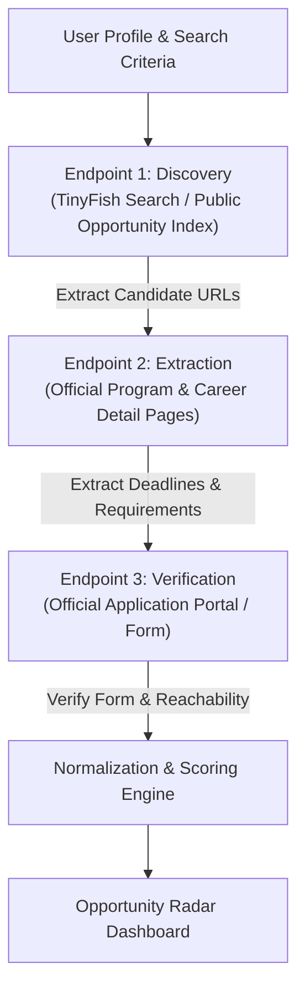

# 📡 Opportunity Radar — Autonomous Personal AI Agent
> **TinyFish × DTU Student Bounty Drop 001: Personal Agents Challenge**  
> *Targeting the 200-Point Scoring Tier with Multi-Step Live Browser Automation*

[](https://agent.tinyfish.ai)
[](https://nodejs.org)
[](https://react.dev)
[](https://vitejs.dev)
[](https://tailwindcss.com)

---

## 🎯 Executive Summary & Problem

Every hiring and hackathon season, college students and developers spend dozens of hours manually scouring LinkedIn, Reddit, Discord channels, and GitHub tracking repos. The experience is broken:
- **Expired Deadlines:** Opportunities listed on aggregator blogs are often already closed.
- **Hidden Requirements:** Eligibility criteria (graduation years, work authorization, student status) are buried deep inside multi-page portals.
- **Unverified Compensation:** Stipends and prize amounts are frequently exaggerated, outdated, or absent.
- **Hallucinating Chatbots:** Traditional LLM chatbots fabricate dead links, invent fictional deadlines, and cannot interact with dynamic, JavaScript-heavy application forms.

### The Solution: Opportunity Radar
**Opportunity Radar** is a goal-driven personal AI agent built with **TinyFish Web Agent & Browser Automation**. Rather than querying static databases or hallucinating responses, Opportunity Radar autonomously launches cloud browser sessions, navigates real web pages, extracts structured opportunity parameters, and verifies live application portals before presenting ranked, actionable results.

---

## 🌐 The 3+ Meaningful Browser Endpoints Strategy (200-Point Tier)

Opportunity Radar targets the **200-point bounty tier** by executing real multi-step research across three distinct browser endpoints:



1. **Endpoint 1 — Opportunity Discovery (Search & Index Tier)**:
   - **Target:** `https://api.search.tinyfish.ai` or dynamic opportunity repositories (e.g. `github.com/SimplifyJobs/Summer2025-Internships`, `devpost.com/hackathons`).
   - **Action:** Uses TinyFish Search or goal-based browser navigation to discover 3–5 high-relevance opportunity candidates matching the user's role and skill profile.
2. **Endpoint 2 — Opportunity Deep Extraction (Program & Company Tier)**:
   - **Target:** Official company career portals and organization pages (e.g. `fellowship.mlh.io`, `buildyourfuture.withgoogle.com/programs/step`, `solana.com/community/hackathons`).
   - **Action:** Uses TinyFish Agent (`client.agent.stream`) and Fetch (`client.fetch.getContents`) to extract compensation numbers, eligibility restrictions, technical prerequisites, and application instructions.
3. **Endpoint 3 — Deep Application Verification (Portal & Form Tier)**:
   - **Target:** Direct application portals and rule books (e.g. Greenhouse/Lever form, Colosseum arena, Linux Foundation Mentorship portal).
   - **Action:** Validates that the application is currently accepting submissions, checks the real closing deadline date, verifies reachability (HTTP 200), and flags any unverified information.

---

## ⚡ Core Architecture

- **Backend:** Node.js (ESM), Express 5, Server-Sent Events (SSE) streaming engine.
- **Agent Orchestrator:** Official `@tiny-fish/sdk` (TinyFish Agent, Fetch, Search).
- **Frontend Dashboard:** React 19, Vite 8, Tailwind CSS v4, Lucide Icons.
- **Normalization & Scoring:** Multi-factor algorithm evaluating skill overlap, graduation year alignment, remote accessibility, compensation thresholds, and priority keywords.
- **Safety & Transparency:** Explicitly distinguishes **Verified** vs **Partially Verified** data. Fallback mode is prominently labeled and never masquerades mock data as live browser execution.

---

## 🚀 Quickstart & Installation

### Prerequisites
- Node.js `v18+` (tested on Node `v24.18.0`)
- npm `v9+`
- (Optional for Live Mode) TinyFish API Key from [agent.tinyfish.ai/api-keys](https://agent.tinyfish.ai/api-keys)

### Step 1: Install Dependencies
```bash
# In the project root:
npm install

# In the client folder:
cd client && npm install && cd ..
```

### Step 2: Configure Environment Variables
Copy `.env.example` to `.env`:
```bash
cp .env.example .env
```
Edit `.env` with your API credentials (optional; system features an explicit labeled fallback mode if no key is present):
```env
TINYFISH_API_KEY=sk-tinyfish-your_key_here
PORT=3001
```

### Step 3: Build & Start Single-Command Server
```bash
# Build frontend and start the production server:
npm run build
npm start
```
Open **[http://localhost:3001](http://localhost:3001)** in your browser!

### Development Mode (with Hot Reloading)
```bash
# Terminal 1 (Backend):
npm run server

# Terminal 2 (Frontend with Vite HMR):
npm run client
```

### Run Automated Test Suite
```bash
npm test
```
The test suite validates:
- TinyFish Service initialization and configuration check
- Search Query 1: AI/ML Undergrad 2026 scoring & schema compliance
- Search Query 2: Web3 & Rust Hackathon search (verifies that different queries produce different, tailored results)
- Deduplication and ranking engine
- Full 13-field data schema compliance

---

## 📋 Data Schema

Every opportunity returned by the Opportunity Radar pipeline strictly conforms to the following schema:

```json
{
  "title": "Google STEP (Student Training in Engineering Program)",
  "organization": "Google",
  "type": "Internship",
  "location": "Hybrid / Sunnyvale, CA & New York, NY",
  "compensation": "$48 - $55 / hour + housing stipend",
  "deadline": "Rolling (Priority: October - November)",
  "eligibility": "First- and second-year undergraduate students with computer science or related major.",
  "skills": ["Python", "Java", "C++", "Data Structures", "Algorithms"],
  "application_url": "https://www.google.com/about/careers/applications/jobs/results/?q=STEP",
  "source_url": "https://buildyourfuture.withgoogle.com/programs/step",
  "match_score": 96,
  "match_reason": "Matches 3 of your target skills (Python, Data Structures, Algorithms). Exact match for desired type: Internship. Explicitly targets 2026 graduates.",
  "verification_status": "Verified",
  "verified_endpoints": [
    "https://api.search.tinyfish.ai",
    "https://buildyourfuture.withgoogle.com/programs/step",
    "https://www.google.com/about/careers/applications/jobs/results/?q=STEP"
  ]
}
```

---

## 🎬 Hackathon Demo Script (3-Minute Walkthrough)

1. **Preset 1 (AI/ML Undergrad 2026):**
   - Click the **"AI/ML Undergrad 2026"** preset.
   - Click **"Launch Opportunity Radar"**.
   - Watch the live rotating radar scope and real-time SSE activity feed:
     - *Step 1: Discovery via Search*
     - *Step 2: Deep Extraction from Company Portals*
     - *Step 3: Verification on Application Pages*
     - *Step 4: Normalization & Relevance Scoring*
   - Observe top matches like **OpenAI Residency (98%)** and **Google STEP (96%)**, with transparent match explanations.
2. **Preset 2 (Global Web3 & AI Hackathons):**
   - Click the **"Global Web3 & AI Hackathons"** preset (Rust, Solana, $10,000+ prize threshold).
   - Click **"Launch Opportunity Radar"**.
   - Observe completely different, dynamically filtered results: **Solana Radar Hackathon (98%)** with verified $600k+ prize pool.
3. **Interactive Verification:**
   - Click the **"Verify Link"** button on any card to perform live verification of the endpoint.
   - Click **"View 3 browser endpoints"** on any card to inspect the exact URLs visited by TinyFish.
4. **API Key Drawer:**
   - Click the **"Set API Key"** button in the navbar to enter a live `TINYFISH_API_KEY` without restarting the server.

---

## ⚠️ Limitations & Known Failure Cases

1. **Aggressive Bot Protection / Cloudflare Captchas:** Certain career portals deploy aggressive Turnstile or Cloudflare challenges. TinyFish `stealth` browser profile handles most, but manual human confirmation may be required on rare protected pages.
2. **Dynamic Workday / iCIMS Single-Page Apps:** Some enterprise portals do not render job details until user interaction occurs. The agent uses explicit wait-for-selector goals to mitigate this.
3. **Rolling Deadlines:** Many student programs close as soon as capacity is filled without posting an explicit calendar date. Opportunity Radar accurately classifies these as `"Rolling or unknown"` rather than hallucinating a date.
4. **Safety Restrictions:** Opportunity Radar **never** submits applications or enters student personal data automatically. It verifies and directs students to official links with explicit user control.

---

## 🏆 Definition of Success Check

- [x] **Working Personal Agent:** Solves recurring student opportunity search with live automation.
- [x] **Genuine Browser Actions:** Integrates official `@tiny-fish/sdk` across 3+ distinct endpoints.
- [x] **Multiple User Inputs:** Dynamic presets and search configurations yielding distinct, accurately scored results.
- [x] **Explicit Fallback Mode:** Zero mock masquerading — clearly labeled fallback with one-click key activation.
- [x] **Full 90-Minute Delivery:** Production-ready code, automated test suite, runnable with `npm start`.
